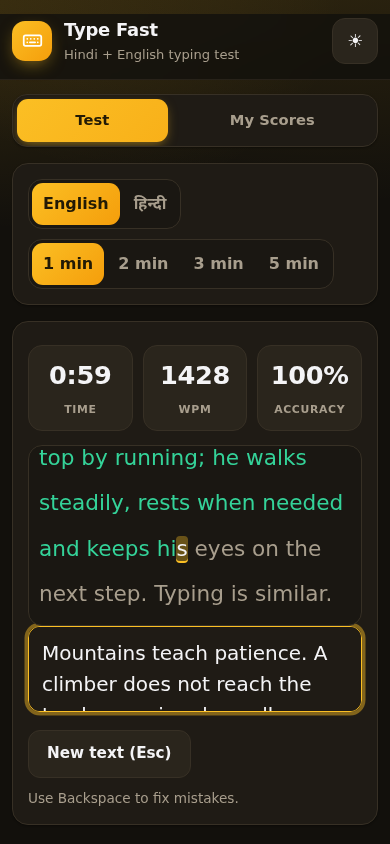
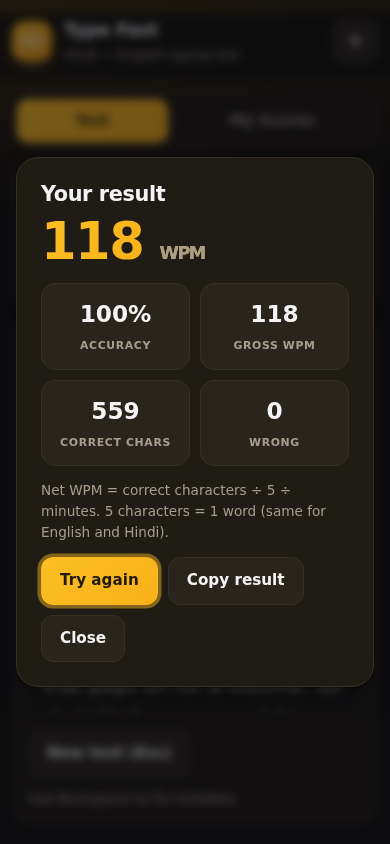
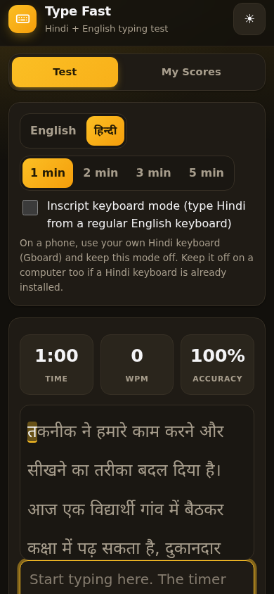
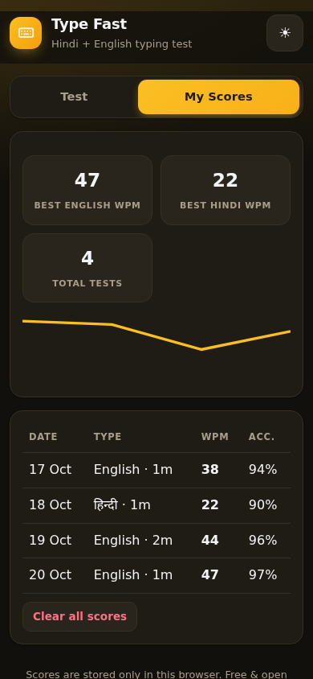
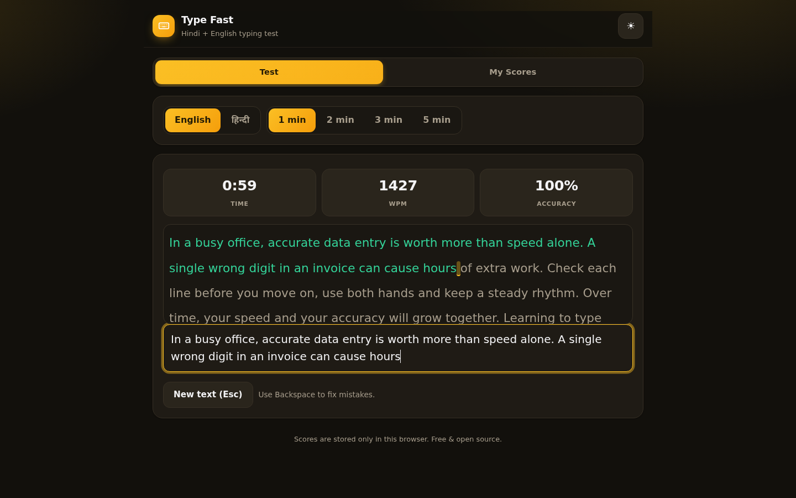

# Type Fast - Hindi + English Typing Test

A clean typing speed test for Hindi and English with live WPM and accuracy, an Inscript keyboard mode, and score history. Good practice for government exams and data-entry work.

**Live app:** https://akash991833.github.io/hindi-english-typing-test-app/

Free, no sign-up, no ads. Works offline after the first visit. Scores are saved on your device only.

## Features

- English and Hindi passages, 1 / 2 / 3 / 5 minute tests
- Live timer, WPM and accuracy while you type; correct characters highlighted as you go
- Inscript keyboard mode: type Hindi from a regular English keyboard, with a built-in key chart
- Result screen with net WPM, gross WPM, accuracy and personal-best detection
- Score history (last 50 tests) with best scores and a trend chart
- Devanagari-aware measurement: grapheme clusters are counted correctly, and 5 characters = 1 word for both languages
- Dark and light mode, works offline, installable on phone

## How to use

1. Pick English or हिन्दी, choose a duration, and start typing - the timer starts on your first character.
2. On a phone, use your own Hindi keyboard (Gboard). On a computer without a Hindi keyboard, turn on Inscript mode.
3. Check My Scores to track your progress.

## Screenshots








## Good to know (limits)

- Net WPM = correct characters ÷ 5 ÷ minutes (the standard government-exam style measure).
- Scores are stored only in this browser. Clearing browser data deletes them.

## Run it yourself

No build step. Clone the repo and open `index.html`, or serve the folder with any static server:

```bash
git clone https://github.com/AKASH991833/hindi-english-typing-test-app.git
cd hindi-english-typing-test-app
python3 -m http.server 8080
```

Plain HTML, CSS and JavaScript. No tracking, no external requests.

## Privacy

No account, no server, no analytics. Scores stay in your browser's local storage.

## License

MIT
